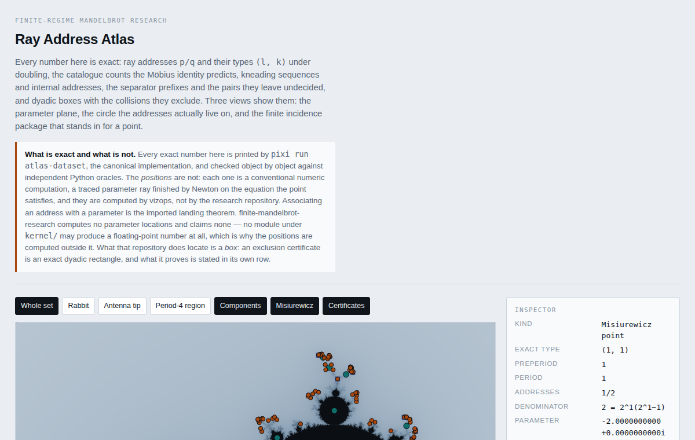
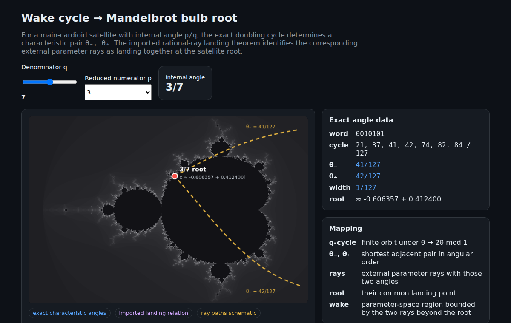
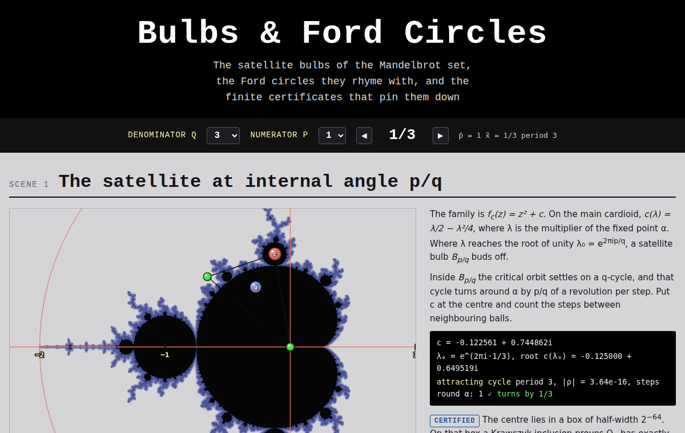
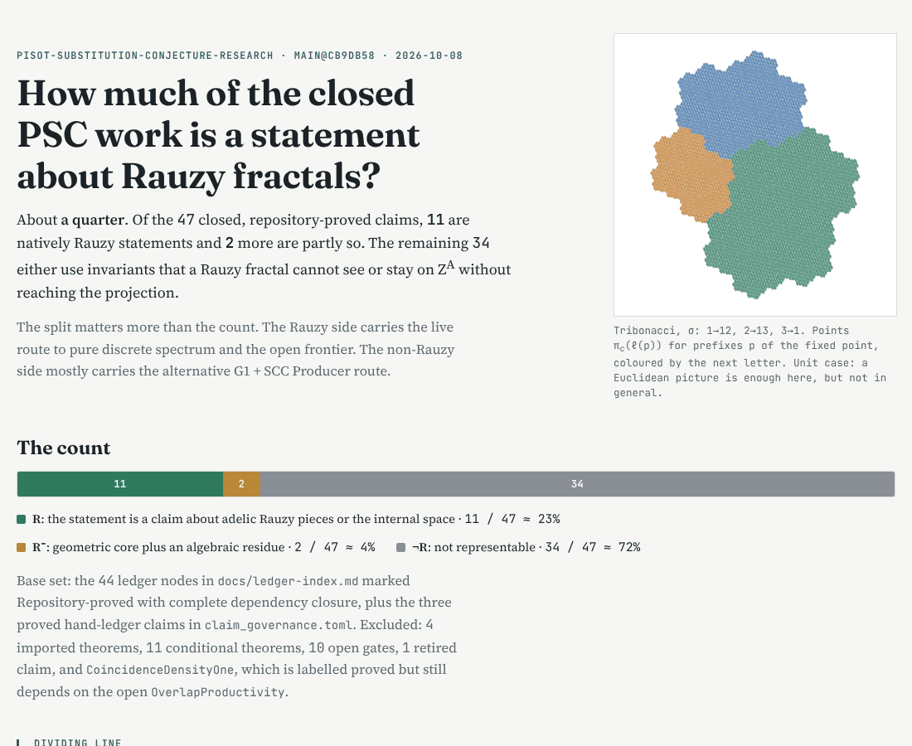
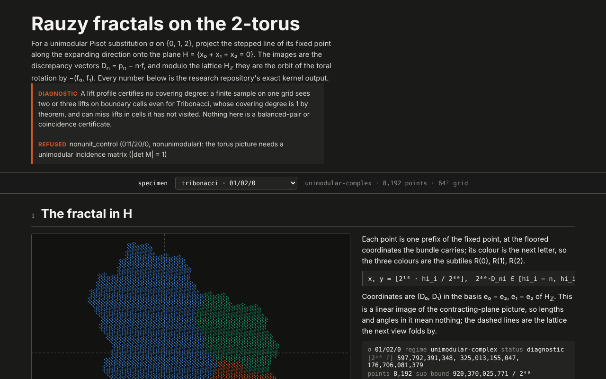

# Pages

Five surfaces are self-contained HTML pages rather than manim scenes: an
atlas, an interactive wake explorer, a six-scene tour of the satellite
bulbs, pisot-substitution-conjecture-research's Rauzy representability
map, copied byte for byte and stamped, and that repository's exact
Rauzy-torus evidence bundle, drawn in four views. Each is a `[[page]]` entry in
[`vizops/sources.toml`](https://github.com/larsbx/math-vizops/blob/main/vizops/sources.toml),
built into `out/<id>.html` by `python -m vizops page <id>`, and never
committed. Open the file in a browser; [[Rendering and viewing]] covers the
command and its outcomes.

Every page is stamped with the digest of each file it read and carries the
same line a frame does: it depicts its sources at those digests and
authorizes nothing. A published copy is a snapshot of one build; rebuild and
republish it when its sources move.

<!-- BEGIN generated page gallery (python -m vizops --write); do not edit between the markers -->
<!-- Rendered by vizops/surfaces.py from the [[page]] entries in vizops/sources.toml and the stills in wiki/images/. -->

### Ray address atlas

`python -m vizops page mandelbrot-atlas` — reads [`kernel/mojo/entrypoints/atlas_dataset.mojo`](https://github.com/larsbx/finite-mandelbrot-research/blob/main/kernel/mojo/entrypoints/atlas_dataset.mojo) in `larsbx/finite-mandelbrot-research`, [`docs/structure_crosswalk.json`](https://github.com/larsbx/finite-mandelbrot-research/blob/main/docs/structure_crosswalk.json) in `larsbx/finite-mandelbrot-research`.

**View it:** [Ray address atlas](https://claude.ai/artifact/9LDj75kM1AFBjZLmDxuFgA) — a published build, private to its owner until shared.

> The exact sections are that emitter's, checked against the Python oracles by tests/test_atlas_dataset.py; component names and ids are the structure crosswalk's, matched by exact root rays, with emitted tuning labels retained as aliases. The positions are traced by vizops/atlas/trace.py and are a placement, not a claim.

### Wake cycle to Mandelbrot bulb root

`python -m vizops page wake-to-mandelbrot` — reads [`oracles/rational_dynamics_py`](https://github.com/larsbx/finite-math-kernels/tree/9d27bc4508844e72ffc61acb8ba172f7346707d8/oracles/rational_dynamics_py) in `larsbx/finite-math-kernels` (vendored at `9d27bc450884`).

> Rotation words, doubling cycles and characteristic pairs are the vendored rational_dynamics_py's (ported from the bulbs repository's kernel/bulbford/wake.py); the raster, the root coordinate and the dashed rays are display aids. The landing relation is the imported [DH/Mil00].

### Bulbs & Ford Circles

`python -m vizops page bulbs-and-ford-circles` — reads [`experiments/data/center_certificates.json`](https://github.com/larsbx/mandelbrot-bulbs-and-ford-circles-research/blob/main/experiments/data/center_certificates.json) in `larsbx/mandelbrot-bulbs-and-ford-circles-research`, [`experiments/data/antipode_certificates.json`](https://github.com/larsbx/mandelbrot-bulbs-and-ford-circles-research/blob/main/experiments/data/antipode_certificates.json) in `larsbx/mandelbrot-bulbs-and-ford-circles-research`, [`experiments/data/kappa_q1009.json`](https://github.com/larsbx/mandelbrot-bulbs-and-ford-circles-research/blob/main/experiments/data/kappa_q1009.json) in `larsbx/mandelbrot-bulbs-and-ford-circles-research`, [`conformance/cyclotomic_germ_v1.json`](https://github.com/larsbx/finite-math-kernels/blob/main/conformance/cyclotomic_germ_v1.json) in `larsbx/finite-math-kernels`.

**View it:** [Bulbs & Ford Circles](https://claude.ai/artifact/X6cYWjyUe8VZLRL75dorKh) — a published build, private to its owner until shared.

> Certified centre and antipode boxes, G brackets and the q = 1009 sweep are that repository's; the exact indices are finite-math-kernels' cyclotomic germ vectors. The page transcribes them; every certificate it shows was issued upstream.

### PSC Rauzy representability

`python -m vizops page psc-rauzy-representability` — reads [`docs/rauzy-representability-2026-10-08.html`](https://github.com/larsbx/pisot-substitution-conjecture-research/blob/main/docs/rauzy-representability-2026-10-08.html) in `larsbx/pisot-substitution-conjecture-research`.

**View it:** [PSC Rauzy representability](https://claude.ai/artifact/6gdPGTXbt68XLNdQ4KqSbt) — a published build, private to its owner until shared.

> The classification of the closed claims and the figures are that repository's page, copied byte for byte; it is an interpretive map with no ledger status there, and vizops adds only the stamp.

### PSC Rauzy fractals on the 2-torus

`python -m vizops page psc-rauzy-torus` — reads [`evidence/rauzy-torus-2026-10-21/named.jsonl`](https://github.com/larsbx/pisot-substitution-conjecture-research/blob/main/evidence/rauzy-torus-2026-10-21/named.jsonl) in `larsbx/pisot-substitution-conjecture-research`, [`evidence/rauzy-torus-2026-10-21/corpus.jsonl`](https://github.com/larsbx/pisot-substitution-conjecture-research/blob/main/evidence/rauzy-torus-2026-10-21/corpus.jsonl) in `larsbx/pisot-substitution-conjecture-research`, [`evidence/rauzy-torus-2026-10-21/SHA256SUMS`](https://github.com/larsbx/pisot-substitution-conjecture-research/blob/main/evidence/rauzy-torus-2026-10-21/SHA256SUMS) in `larsbx/pisot-substitution-conjecture-research`.

**View it:** [PSC Rauzy fractals on the 2-torus](https://claude.ai/artifact/2w18PosvJWmAnVWUiTx69P) — a published build, private to its owner until shared.

> Points, subtile letters, certified frequency floors and lift profiles are that repository's exact kernel output, replayed there by an independent oracle; the bundle is diagnostic and a lift profile certifies no covering degree. The fold of points, the torus embedding and the frequency-triangle placement are display aids.

### PSC Rauzy tile contacts

`python -m vizops page psc-rauzy-contacts` — reads [`evidence/rauzy-contacts-2026-10-22/contacts-named.jsonl`](https://github.com/larsbx/pisot-substitution-conjecture-research/blob/main/evidence/rauzy-contacts-2026-10-22/contacts-named.jsonl) in `larsbx/pisot-substitution-conjecture-research`, [`evidence/rauzy-contacts-2026-10-22/contacts-corpus.jsonl`](https://github.com/larsbx/pisot-substitution-conjecture-research/blob/main/evidence/rauzy-contacts-2026-10-22/contacts-corpus.jsonl) in `larsbx/pisot-substitution-conjecture-research`, [`evidence/rauzy-contacts-2026-10-22/SHA256SUMS`](https://github.com/larsbx/pisot-substitution-conjecture-research/blob/main/evidence/rauzy-contacts-2026-10-22/SHA256SUMS) in `larsbx/pisot-substitution-conjecture-research`.

_No still published yet._ Build the page, capture it, and commit `wiki/images/psc-rauzy-contacts.png`.

> Box verdicts, contacts and lattice neighbours are that repository's exact kernel output (psc/rauzy_contacts.mojo), replayed there by an independent oracle on a different potential-overlap region. Contacts rest on the cited Siegel-Thuswaldner boundary-graph criterion, and covering degree 1 is upstream's cited consequence of a productive box, quoted and never asserted here. Translating a subtile's points by a contact is a display aid.

<!-- END generated page gallery -->
